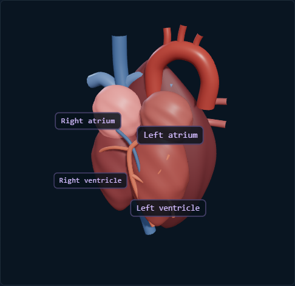

# CardioVision AI

**Explore ECG recordings with transparent signal processing, interactive waveforms, an educational 3D heart illustration, and downloadable reports.**

CardioVision AI is a research-and-education workstation built with React, TypeScript, Vite, FastAPI, NumPy/SciPy, Plotly.js, and Three.js. It supports a standard ECG workflow and a separate, experimental fetal ECG extraction workflow for suitable maternal-abdominal EDF recordings.

> **Project status: functional research prototype.** Upload, analysis, visualizations, local explanations, and PDF/JSON exports are implemented and covered by backend tests. The fetal extraction algorithm is experimental and not clinically validated. The procedural adult heart is educational rather than a medical-grade anatomical model. This software is not a medical device.

[](https://github.com/bhavadeepsait55-ai/cardiovision-ai)

> The repository is private by default. There is no release, hosted deployment, coverage badge, or public license claim.

## Contents

- [Features](#features)
- [Screenshots](#screenshots)
- [Technology](#technology)
- [Requirements](#system-requirements)
- [Quick start](#quick-start)
- [Configuration](#configuration)
- [Usage](#usage)
- [Processing methodology](#processing-methodology)
- [API](#api)
- [Project structure](#project-structure)
- [Testing and development](#testing-and-development)
- [Troubleshooting](#troubleshooting)
- [Privacy and medical disclaimer](#privacy-and-medical-disclaimer)
- [Contributing and roadmap](#contributing-and-roadmap)
- [License](#license)

## Features

| Capability | Status | Notes |
|---|---|---|
| Upload `.edf` (continuous EDF/EDF+C), CSV, and TXT | Implemented | Temporary in-memory processing; 25 MB upload limit |
| Channel metadata and waveform preview | Implemented | CSV/TXT require an explicitly entered sample rate |
| Standard ECG filtering and candidate R-peak analysis | Implemented | Exploratory signal-processing estimates, not diagnoses |
| RR statistics and conditional SDNN/RMSSD | Implemented | HRV outputs are withheld when there are too few eligible intervals |
| Fetal ECG research extraction | Experimental | NLMS maternal cancellation for suitable multichannel EDF only |
| Interactive Plotly waveform lab | Implemented | Zoom, pan, hover, event selection, and synchronized chart ranges |
| Interactive 3D heart explorer | Implemented, illustrative | Procedural adult model; anatomy is not atlas-quality or patient-specific |
| ECG-linked educational timeline | Implemented | Uses detected sample indices and timestamps; does not infer internal activation |
| Local explanation assistant | Implemented | Template-based; no LLM, external provider, or signal transmission |
| PDF report and JSON export | Implemented | Evidence-grounded research summaries with limitations and disclaimer |
| Patient history, multi-user access control, clinical validation | Not implemented | Not suitable for clinical or multi-tenant deployment |
| Fetal anatomical model | Not implemented | The adult illustration is never labeled as a fetal reconstruction |

Details and limitations are in [ECG processing](docs/ECG_PROCESSING.md) and [architecture](docs/ARCHITECTURE.md).

## Screenshots



*Genuine browser capture of the application's procedural adult heart view. The screenshot contains no patient recording or identifiable information; this is an educational illustration, not an anatomical atlas.*

For additional screenshots, run the app using [the installation guide](docs/INSTALLATION.md), load only the patient-free synthetic ECG sample, then use your browser's screenshot tool. Save project-owned images under `docs/images/`. Do not include real patient recordings, identifiers, report exports, or the supplied EDF.

## Technology

| Technology | Role |
|---|---|
| React 18, TypeScript, Vite 5 | Frontend UI, type-checking, and development/production builds |
| Tailwind CSS 3 | CSS tooling/dependency; the app's visual system is primarily in `frontend/src/styles.css` |
| Plotly.js / react-plotly.js | Interactive ECG waveform and preview charts |
| Three.js, React Three Fiber, Drei | Procedural educational heart, labels, camera controls, and conduction overlay |
| Python 3.10+ | Backend and signal-processing runtime |
| FastAPI, Pydantic, Uvicorn | HTTP API, request validation, and local ASGI server |
| NumPy, SciPy, pandas | Numeric arrays, filtering, peak detection, and CSV/TXT parsing |
| ReportLab | PDF report generation |
| pytest, FastAPI TestClient, HTTPX | Backend processing, API, and report tests |

EDF files are parsed by the project's `backend/app/edf.py`; pyEDFlib is not required.

## System requirements

- **Operating systems:** Windows, macOS, and Linux are supported by the Python/Node toolchain; the application runs in a modern browser.
- **Python:** 3.10 or later (3.11 is recommended).
- **Node.js/npm:** Node.js 18 or later is required by Vite 5; Node.js 20 LTS is recommended. npm is included with Node.js.
- **Git:** Git 2.x recommended.
- **Browser:** Current Chrome, Edge, Firefox, or Safari. The interactive 3D view requires WebGL support.
- **Memory and disk:** No minimum has been measured. Allow room for Python/npm dependencies and the frontend build; do not upload recordings larger than the configured limits.
- **GPU:** No dedicated GPU is required; WebGL-capable integrated graphics are sufficient for normal use. Rendering performance depends on the device.

## Quick start

The complete, beginner-friendly setup—with separate PowerShell and macOS/Linux instructions—is in [Installation](docs/INSTALLATION.md). These commands assume Python, Node.js/npm, and Git are installed.

### Windows PowerShell

From the folder where you want the project:

```powershell
git clone https://github.com/bhavadeepsait55-ai/cardiovision-ai.git
Set-Location cardiovision-ai

py -3.11 -m venv .venv
.\.venv\Scripts\Activate.ps1
python -m pip install --upgrade pip
python -m pip install -r backend\requirements.txt
```

In **Terminal 1**, from the repository root, start the API:

```powershell
python -m uvicorn backend.app.main:app --host 127.0.0.1 --port 8000
```

In **Terminal 2**, from the repository root, configure the frontend and start Vite:

```powershell
Set-Location frontend
npm ci
Copy-Item ..\.env.example .env
npm run dev
```

Open <http://localhost:5173>. Verify the API in a browser at <http://localhost:8000/api/health>; the response should include `"status":"ok"`.

### macOS/Linux

From the folder where you want the project:

```bash
git clone https://github.com/bhavadeepsait55-ai/cardiovision-ai.git
cd cardiovision-ai

python3.11 -m venv .venv
source .venv/bin/activate
python -m pip install --upgrade pip
python -m pip install -r backend/requirements.txt
```

In **Terminal 1**, from the repository root, start the API:

```bash
python -m uvicorn backend.app.main:app --host 127.0.0.1 --port 8000
```

In **Terminal 2**, from the repository root, configure the frontend and start Vite:

```bash
cd frontend
npm ci
cp ../.env.example .env
npm run dev
```

Open <http://localhost:5173>. Verify the API at <http://localhost:8000/api/health>.

> If GitHub access is not available for your account, use the local project directory instead of the `git clone` steps.

Generate and use patient-free test data from the repository root:

```powershell
python backend\scripts\generate_sample.py --output synthetic_ecg.csv
```

```bash
python backend/scripts/generate_sample.py --output synthetic_ecg.csv
```

The deterministic sample is synthetic ECG-like data for software testing, not clinical or reference-annotated data. Upload requires acknowledging the temporary-processing consent and entering the sample rate (`250` Hz for the generated default).

## Configuration

The backend has no required environment variables. The optional Vite API URL is read from `frontend/.env` at build/start time.

| Variable | Purpose | Example | Required |
|---|---|---|---|
| `VITE_API_BASE_URL` | Frontend base URL for FastAPI | `http://localhost:8000` | No; this is the default |

The root `.env.example` contains placeholders only. Copy it to `frontend/.env` (commands above) to override the frontend API URL. Restart Vite after changing it. The Vite development server uses port `5173`; FastAPI uses port `8000`. There is no optional LLM API key or external 3D asset configuration: explanations run locally and the heart is procedural.

## Usage

1. Start the API and frontend as described above.
2. Select **Upload ECG**. Choose an `.edf` (continuous EDF/EDF+C), CSV, or TXT recording. The server requires consent before upload; uploaded data is held in temporary process memory.
3. For CSV/TXT, enter the recording's known sample frequency and select an amplitude unit only if supported by the source calibration. The app does not guess either value.
4. Inspect the available channels and signal preview. Choose **Standard ECG** for a conventional recording, or **Fetal ECG research** only for suitable multichannel maternal-abdominal EDF recordings.
5. Review the visible processing settings and run the analysis.
6. Inspect raw and processed traces, detected candidate peaks, RR statistics, and quality heuristics in **Signal Analysis**. Selecting a detected event shows its sample-derived timestamp.
7. Open **3D Heart** to explore the illustrative adult model, select structures, change camera views, toggle anatomy/conduction, and step through detected beat timestamps. This is not a patient-specific activation map.
8. Open **Reports** to download a PDF or export the analysis and metadata as JSON.
9. Remove the recording when finished. Recordings expire from memory after 30 minutes and are also lost when the backend process restarts.

The **Explain My ECG Data** panel provides local template-based educational explanations from completed analysis values. It is not a generative AI service.

## Processing methodology

### Standard ECG

The selected channel is median-centered, then filtered with a third-order zero-phase Butterworth bandpass (default **0.5–40 Hz**). An optional second-order notch filter supports **50 Hz** or **60 Hz**, below Nyquist. A prominence-based local-maximum detector proposes candidate R-peaks; it is not a validated beat classifier. RR intervals are computed from sample-index differences and the selected sample rate. Default eligible RR bounds are **250–2500 ms**. SDNN requires at least five eligible intervals and RMSSD at least six. A simple quality heuristic examines flat/extreme sample fractions and event counts.

The UI/API validates that filter parameters fit the sample rate. Very short recordings, non-finite values, flat channels, filter edge conditions, or unsuitable parameters can cause clear analysis errors or insufficient results. Unknown CSV/TXT units remain unknown; EDF uses physical calibration from the file. Filtering and heart-rate estimates do not establish that a recording is normal.

### Fetal ECG research workflow

Fetal research mode is a separate pipeline and accepts EDF only. It bandpass-filters maternal-reference and abdominal-mixture channels over **3–70 Hz**, z-score normalizes both, and applies an NLMS adaptive cancellation filter. It detects maternal peaks in the reference, zeros configurable windows around those peaks in the extracted residual, computes an absolute-value envelope, then detects candidate fetal peaks. A configurable convergence period is excluded from summary rates. The default segment is 60 seconds and default convergence exclusion is 10 seconds.

The sample rate must exceed 140 Hz (the API additionally requires at least 150 Hz); selected channels must have matching sample rate and sample count. NLMS length, step size, maternal suppression window, convergence interval, segment length, detection thresholds, and candidate fetal BPM bounds are configurable. Defaults and failure behavior are described in [ECG processing](docs/ECG_PROCESSING.md). Maternal residuals/artifacts can remain; candidate rates are research outputs, not diagnostic boundaries. The pipeline has not been clinically validated and is not guaranteed to extract fetal ECG reliably.

### 3D and explanations

The adult heart is generated from procedural Three.js geometry. The chambers, vessels, and conduction system are illustrative, not a licensed/reviewed medical atlas. The ECG timeline uses actual detected sample indices, but no ECG value is used to infer 3D anatomy or internal activation. Fetal visualization is not implemented. Explanations use local templates and do not transmit recordings to a provider.

## API

The API base URL defaults to `http://localhost:8000`; OpenAPI docs are available at <http://localhost:8000/docs> when running locally. Detailed payloads and examples are in [API documentation](docs/API.md).

| Method | Path | Purpose |
|---|---|---|
| `GET` | `/api/health` | Service health check |
| `POST` | `/api/upload` | Validate/ingest EDF, CSV, or TXT with required consent |
| `GET` | `/api/recordings/{id}/metadata` | Metadata and bounded waveform previews |
| `POST` | `/api/recordings/{id}/analyze` | Run standard or EDF-only fetal research analysis |
| `GET` | `/api/recordings/{id}/results` | Retrieve completed results and display waveforms |
| `GET` | `/api/recordings/{id}/report` | Generate a PDF report |
| `POST` | `/api/recordings/{id}/explain` | Get a local, template-based educational response |
| `DELETE` | `/api/recordings/{id}` | Delete in-memory recording and results |

## Project structure

```text
cardiovision-ai/
├── .github/workflows/ci.yml     # Backend tests and frontend build
├── backend/
│   ├── app/
│   │   ├── edf.py               # EDF parsing and physical calibration
│   │   ├── main.py              # FastAPI routes, validation, temporary recordings
│   │   ├── processing/          # Standard ECG and fetal research pipelines
│   │   └── reports/pdf.py       # PDF report generation
│   ├── scripts/generate_sample.py
│   ├── tests/                   # Processing/API/report tests
│   └── requirements.txt
├── docs/
│   ├── images/                  # Project-owned screenshots, if added
│   ├── API.md
│   ├── ARCHITECTURE.md
│   ├── ECG_PROCESSING.md
│   └── INSTALLATION.md
├── frontend/
│   ├── src/App.tsx              # Main dashboard and workflows
│   ├── src/HeartScene.tsx       # Procedural interactive heart
│   ├── src/PlotComponent.tsx    # Plotly integration
│   ├── src/styles.css
│   ├── package.json
│   └── package-lock.json
├── .env.example
├── .gitignore
├── CONTRIBUTING.md
├── CHANGELOG.md
├── SECURITY.md
├── README.md
└── fetalecg.py                  # CLI wrapper for fetal research processing
```

Patient recordings, generated reports, dependencies, caches, virtual environments, and build outputs are not part of the repository.

## Testing and development

Run backend tests from the repository root with the Python virtual environment active:

```powershell
python -m pytest backend\tests -q
```

```bash
python -m pytest backend/tests -q
```

There is currently **no frontend test runner or lint script** in `frontend/package.json`. `npm run build` performs the strict TypeScript project build before Vite creates the production bundle:

```powershell
Set-Location frontend
npm ci
npm run build
```

```bash
cd frontend
npm ci
npm run build
```

For frontend development, use `npm run dev`. For a built-site preview use `npm run preview` after `npm run build`. To check the API and processing safely, generate the synthetic sample above. Backend coverage includes synthetic standard ECG measurements, fetal algorithm behavior/limitations, EDF calibration parsing, upload validation, API analysis, PDF output, and deletion. It does not include fetal reference-annotation validation.

See [Contributing](CONTRIBUTING.md) before adding processing methods or replacing the procedural 3D model.

## Troubleshooting

| Problem | Checks and actions |
|---|---|
| `python`, `py`, `node`, or `npm` not found | Install Python 3.10+ and Node.js 18+ (Node 20 recommended); reopen the terminal and run `python --version`, `node --version`, and `npm --version`. On Windows, try `py -3.11`. |
| PowerShell blocks venv activation | Run `Set-ExecutionPolicy -Scope CurrentUser RemoteSigned` only if permitted by your device policy, or use `.\.venv\Scripts\python.exe -m pip ...` without activation. |
| Dependency install fails | Upgrade pip (`python -m pip install --upgrade pip`), verify the supported versions, then retry `python -m pip install -r backend\requirements.txt` or `npm ci` from `frontend`. |
| Port 8000 or 5173 is occupied | Stop the process using that port or select another port. If the API port changes, set `VITE_API_BASE_URL` in `frontend/.env`, add the frontend origin to FastAPI's CORS allowlist if necessary, and restart both services. |
| Frontend cannot contact API / CORS error | Confirm `http://localhost:8000/api/health` responds. The default Vite URL and the API's configured origins are `localhost:5173` and `127.0.0.1:5173`; avoid mixing a different host/port without adjusting configuration. |
| File rejected or unsupported | Current formats are `.edf` (continuous EDF/EDF+C), CSV, and TXT, maximum 25 MB. Discontinuous EDF+D and `.edf+` filename extensions are not supported. Use numeric tabular data and provide sample frequency for CSV/TXT. |
| No EDF channels or fetal workflow unavailable | Confirm that the EDF is readable and contains analyzable signal channels. Fetal mode requires two suitable EDF channels with matching sample rate and sample count and a supported sampling frequency. Select the thoracic reference and abdominal mixture explicitly. |
| Sampling rate or units are wrong | Enter the known CSV/TXT sample rate; unit is unknown unless explicitly declared. Check the EDF channel metadata and calibration instead of guessing. Filter high cutoff must remain below Nyquist. |
| No candidate peaks or low-quality status | Review the trace, channel, sample rate, filter and prominence settings. Noise, clipping, flat signals, short recordings, and detector mismatch can produce insufficient or unreliable candidates. The status is heuristic, not diagnostic. |
| 3D view is blank or slow | Update the browser and graphics drivers; enable WebGL/hardware acceleration; try another current browser or device. The illustration uses browser WebGL and has no external GLB download/fallback asset. |
| PDF report fails | Confirm analysis completed and the recording still exists in the same backend process; check backend terminal output and run `python -m pytest backend\tests -q`. Restarting the API clears temporary recordings. |

## Privacy and medical disclaimer

Obtain authorization before processing any identifiable health data. Recordings are kept in process memory, expire after 30 minutes, are limited to four active recordings and 128 MiB decoded data each, and disappear when the backend restarts. Upload size is limited to 25 MB. The application does not intentionally log uploaded signal values, persist analysis history, or send data to an external AI service. Use the delete control when finished.

This is a local, single-process development application without authentication, cross-user access controls, encrypted storage design, production retention controls, or regulatory validation. Do not expose it to untrusted networks or treat it as HIPAA/GDPR compliant. Production use requires a reviewed security architecture, authorization, transport/storage protections, operational controls, privacy assessment, and appropriate regulatory review.

**Research and educational use only.** ECG measurements and fetal extraction are exploratory and not clinically validated. They do not diagnose or rule out disease, and they are not a substitute for review by a qualified healthcare professional. Seek professional medical advice for health concerns.

## Contributing and roadmap

Contributions should preserve the research-only boundary and document evidence, limitations, and tests. See [CONTRIBUTING.md](CONTRIBUTING.md) for the workflow.

Roadmap items reflect current gaps, not promises:

- Validate fetal extraction against suitable, legally usable reference-annotated data.
- Add frontend interaction tests and linting.
- Replace or augment the procedural heart only with a medically reviewed, appropriately licensed anatomical asset; document provenance and license.
- Improve authenticated multi-user isolation and deployment security before any networked production use.
- Assess accessibility and browser/device performance on a documented test matrix.
- Pursue clinical validation and regulatory assessment only with qualified domain and regulatory teams.

## License

No `LICENSE` file has been added because no project license has been selected or authorized. Until one is chosen, do not assume the source is available for reuse under an open-source license. Third-party dependencies remain subject to their own licenses.
